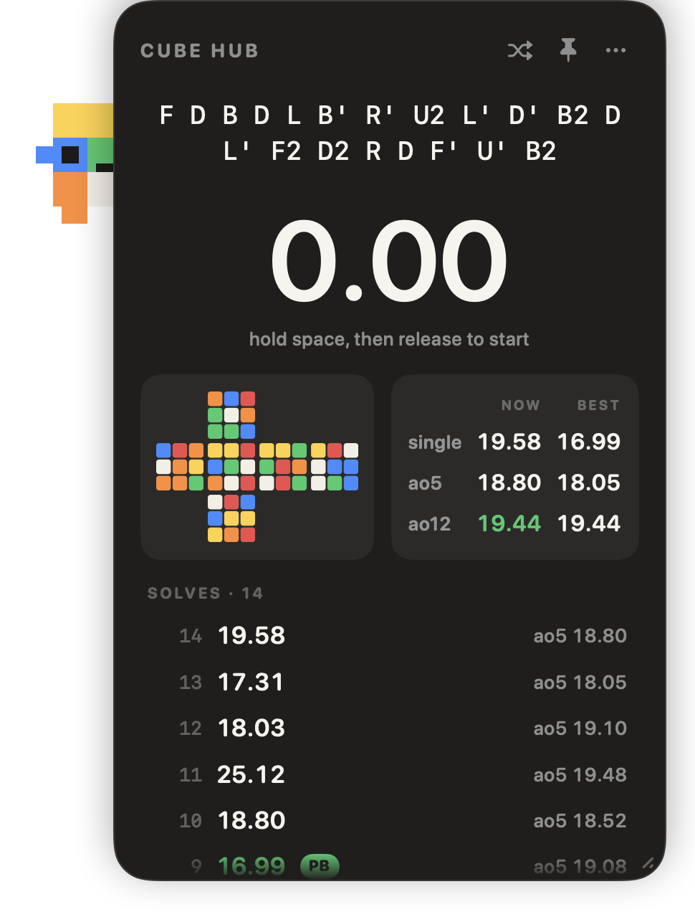
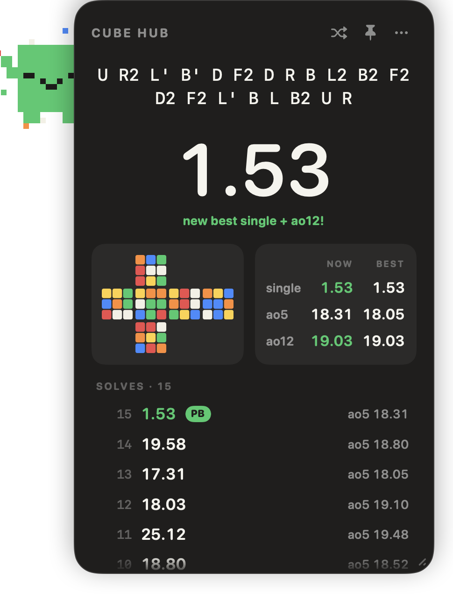

# Cube Hub

A Rubik's cube timer that lives in your Mac's menu bar. Click the icon and a small floating panel appears with a scramble, a timer you drive with the space bar, and your averages.

<p>
  
  
</p>

## What it does

- **Scrambles.** A fresh 20-move scramble for every solve, with a picture of the scrambled cube so you can check you scrambled correctly. The picture assumes white on top and green facing you.
- **Timer.** Hold space until the time turns green, release to start, press space to stop.
- **Averages.** Your current and best single, average of 5 and average of 12. Averages drop the fastest and slowest solve, the way competitions do.
- **History.** Every solve is saved with its scramble and survives restarts.
- **Cubby.** A pixel cube who peeks out from behind the panel. Its face is the front of the scrambled cube, it twists while you solve, and it celebrates when you set a new best.

## Install

You need macOS 15 or later. The app runs on both Apple Silicon and Intel Macs.

1. Download [CubeHub.zip](https://github.com/AK-DEV12/cube-hub/releases/latest/download/CubeHub.zip) and unzip it.
2. Drag **CubeHub** into your Applications folder and open it.
3. macOS will refuse to open it the first time, because the app isn't signed with a paid Apple developer account. Click **Done**, then open **System Settings › Privacy & Security**, scroll down to the message about Cube Hub, and click **Open Anyway**. You only do this once.

If you'd rather use Terminal for step 3:

```bash
xattr -dr com.apple.quarantine /Applications/CubeHub.app
```

Cube Hub has no Dock icon. Look for the small cube face in the menu bar.

## Using it

Click the menu bar icon to show or hide the panel. Right-click it for the menu, which is also behind the **…** button on the panel.

| Key | What it does |
|---|---|
| Space (hold, then release) | Start the timer |
| Space | Stop the timer |
| Esc | Throw away the solve in progress |
| ⌘R | New scramble |
| ⌘⌫ | Delete the last solve |
| ⌘= and ⌘- | Make the panel bigger or smaller |
| ⌘T | Keep the panel on top of other windows |
| ⌘W | Hide the panel |
| ⌘Q | Quit |

The panel needs keyboard focus for the space bar to work, so click it once first.

- **Move it** by dragging anywhere on the panel.
- **Resize it** by dragging the grip in the bottom-right corner. Wider makes everything bigger; shorter shows less at once, down to just the scramble and timer.
- **Scroll** the panel to reach whatever doesn't fit.
- **Delete a solve** by hovering over it and clicking the ×. Right-click a solve to copy its scramble.

To start Cube Hub when you log in, choose **Open at Login** from the menu.

## Your solves

Solves are stored on your Mac in `~/Library/Application Support/CubeHub/solves.json`, and nowhere else. **Show Solves File in Finder** in the menu takes you there. Copy that file to back up your times or move them to another Mac.

## Build it yourself

You need Xcode or its command line tools.

```bash
git clone https://github.com/AK-DEV12/cube-hub.git
cd cube-hub
./scripts/build-app.sh
open build/CubeHub.app
```

An app you build yourself opens without the Privacy & Security step.

To run the tests:

```bash
swift test
```

## How it's put together

- `Sources/CubeHubCore` holds the logic with no interface attached: scramble generation, the cube simulation behind the preview, averages, and saving solves. This is what the tests cover.
- `Sources/CubeHub` is the app: the menu bar item, the floating panel, the timer, and Cubby.
- `scripts/build-app.sh` builds the package and wraps it into `CubeHub.app`. Add `--zip` to also produce the zip that gets attached to a release.

Scrambles are random sequences of moves rather than the random-state scrambles used in official competitions.
